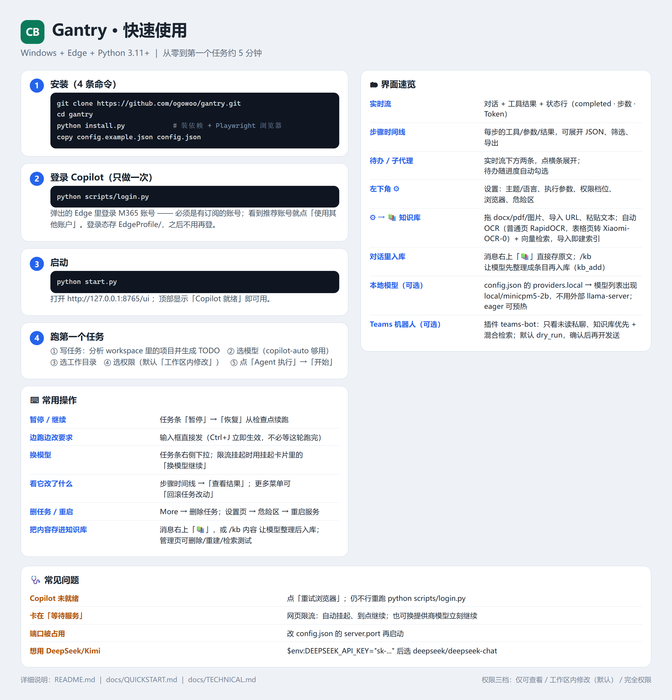
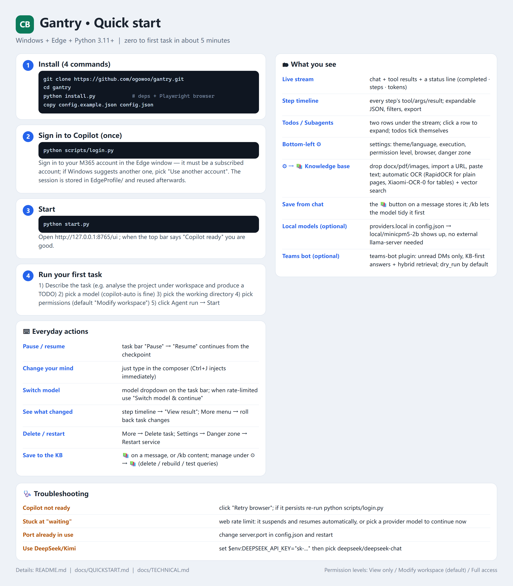

# 快速使用手册（一页版）

> 目标：**5 分钟内**从零跑到第一个任务。更细的说明看 [README](../README.md)。
> 本文覆盖到 `v11.0.0-preview.59`（含知识库/OCR、本地模型、Teams 机器人插件）。

## 一页图（可直接保存/转发）

| 简体中文 | 繁體中文 | English |
|---|---|---|
|  |  |  |

- 简体：[quickstart-zh.png](quickstart-zh.png)
- 繁體：[quickstart-zh-TW.png](quickstart-zh-TW.png)
- English：[quickstart-en.png](quickstart-en.png)

> 图由 `python scripts/make_quickstart_card.py` 生成（改文案后重跑即可）；
> 卡片里已包含 v11 新增的**知识库（OCR + 向量检索 + 对话入库）**、**本地模型**、**Teams 机器人**。

## 1. 准备

- Windows 10/11（其他系统把 `config.json` 的 `browser_channel` 改成 `chrome`）
- Microsoft Edge（已登录能访问 Copilot 的账号）
- **Python 3.11+**（`python -V` 确认）

## 2. 安装（4 条命令）

```powershell
git clone https://github.com/ogowoo/gantry.git
cd gantry
python install.py                                   # 装依赖 + Playwright 浏览器
python install.py --ocr                              # 可选：扫描件/图片 OCR（RapidOCR，约 20 MB）
python install.py --xiaomi                           # 可选：表格/公式解析（Xiaomi-OCR-0，装 torch+transformers，较大）
copy config.example.json config.json                 # 首次需要
```

> **什么都不装也能用**：纯文字知识库（`md/txt/docx/pdf` 文本层）不需要 OCR；
> `--ocr` 只是给扫描件/截图加能力，`--xiaomi` 再加"表格转 OTSL、公式转 LaTeX"。
> 装完可在 `/v1/plugins/kb/api/ocr` 看到 `rapidocr` / `xiaomi` / `effective` 三个字段。

## 3. 登录 Copilot（只做一次）

```powershell
python scripts/login.py
```

弹出的 Edge 窗口里登录你的 M365 账号（**必须用有订阅的账号**，看到推荐账号就点「使用其他账户」），
确认能打开 Copilot 聊天页后，回到命令行按回车。

登录态存在 `EdgeProfile/`，之后不用再登。

## 4. 启动

```powershell
python start.py
```

浏览器打开 **http://127.0.0.1:8765/ui** ，顶部状态显示 `Copilot 就绪` 即可用。
（`Copilot 未就绪` 就点界面右上「重试浏览器」，或在自动化窗口里重新登录。）

## 5. 跑第一个任务

在首页输入框里：

1. **写任务**：`分析 workspace 里的项目并生成 TODO`
2. **选模型**（左下）：`copilot-auto` 够用；要更强的推理选 `Think deeper`
3. **选目录**：`工作目录` 填相对路径（默认 `workspace`）
4. **选权限**：`🛠 工作区内修改`（默认）——只改工作区文件；改不了就换 `⚠ 完全权限`
5. **点「Agent 执行」→「开始」**

## 6. 界面速览

| 在哪 | 看什么 |
|---|---|
| **实时流** | 对话、工具结果、当前状态一行（`completed · 步 388 · Token`） |
| **步骤时间线** | 每一步的工具/参数/结果，可展开 JSON，可筛选/导出 |
| **待办 / 子代理** | 实时流下方两条：点横条展开；待办会随进度自动勾选 |
| **左下角 ⚙** | 设置：主题/语言、执行参数、权限档位、浏览器、知识库（📚）、危险区（重启/终止） |

## 7. 常用操作

| 想做的事 | 怎么做 |
|---|---|
| 暂停 / 继续 | 任务条上「暂停」；再点「恢复」从检查点续跑 |
| 中途改要求 | 输入框直接发消息（Ctrl+J 可边跑边插入，立即生效） |
| 换模型 | 任务条右侧模型下拉；限流挂起时挂起卡片里可「换模型继续」 |
| 看它到底改了什么 | 步骤时间线 → 该步「查看结果」；更多菜单里有「回滚任务改动…」 |
| 删任务 | 任务条「More → 删除任务」（会问要不要连 Copilot 网页记录一起删） |
| 重启服务 | 设置页「危险区 → 重启服务」（正在跑的任务会中断，可恢复） |

## 8. 常见问题

| 现象 | 处理 |
|---|---|
| `Copilot 未就绪 / 需要登录` | 点「重试浏览器」；仍不行就重跑 `python scripts/login.py` |
| 任务卡在「等待服务」 | Copilot 网页限流：会自动挂起、到点继续；也可在挂起卡片里换提供商模型立刻继续 |
| 端口被占用 | `config.json` 的 `server.port` 改个值再启动 |
| 想用 DeepSeek/Kimi/OpenAI | 设环境变量（如 `$env:DEEPSEEK_API_KEY="sk-..."`）后，模型列表里会出现 `deepseek/deepseek-chat` |

## 9. 可选：当 OpenAI 接口用

```python
from openai import OpenAI
client = OpenAI(base_url="http://127.0.0.1:8765/v1", api_key="unused")
print(client.chat.completions.create(
    model="copilot-auto",
    messages=[{"role": "user", "content": "你好"}],
).choices[0].message.content)
```

## 10. 知识库（OCR + 向量检索 + 对话入库）

放在 `data/kb/**/*.md`，导入时自动切块、建 FTS5 与向量索引，供 Agent / Teams 机器人 / API 检索。

**管理页**：`/ui/` → ⚙ 设置 → **📚 知识库**

| 能力 | 怎么用 |
|---|---|
| 文件导入 | 拖拽/选择：`docx` `pdf` `xlsx` `pptx` `md` `txt` `csv` `html` 和图片（`png/jpg/...`） |
| 网页 | 填 URL →「导入 URL」（取正文，标题用 `<title>`） |
| 粘贴文本 | 展开「粘贴文本入库」，填标题后导入 |
| 收件箱 | 把文件丢进 `data/kb/inbox/`，点「收件箱」批量导入 |
| 删除 / 重建 | 列表右侧 ✕；「重建索引」做增量重建 |
| 检索测试 | 输入问题，看后端（`hybrid(local:…)`）与分数 |

**OCR（扫描件 / 图片）**：`config.json` 的 `kb.ocr.engine`

- `auto`（默认）：普通页走 **RapidOCR**（20 MB，约 0.7 秒/张），稀疏或表格状页面自动转 **Xiaomi-OCR-0**（0.8B，表格输出 OTSL、公式 LaTeX，约 6 秒/页）
- `rapidocr` / `xiaomi`：强制其一
- `kb.ocr.eager: true`：启动后台预热 Xiaomi，避免第一次表格页等约 30 秒
- 扫描件没文本层时自动 OCR；`.doc/.xls/.ppt` 请先另存为新格式

**向量检索**：`kb.embedding.backend` = `local`（进程内 Qwen3-Embedding，默认）/
`http`/`hash`/`off`；打分 = `0.75 × 余弦 + 0.25 × 词面覆盖率`，专有词与同义改写都不丢。

**对话入库（三种）**

1. 消息右上 **📚**：把这条消息原文直接存库（不经过模型）；
2. `/kb 内容`：让模型先整理成条目（去重、分点、加标题）再入库；
3. 模型自己调 `kb_add` 工具（`text` / `url` / `paths` 都行）。

## 11. 向量库：自带的，不用另装

向量检索**内置**，不需要 Chroma / Milvus / sqlite-vec，也不需要额外 pip 包：

- 向量存在**同一个** `data/kb.db` 里，表 `chunks_vec(chunk_id, model, dim, vec, at)`；
- 余弦相似度在进程内算（有 numpy 走矩阵乘，没有就纯 Python，两条路径结果一致）；
- 分块只算一次：按 `chunk_id` 对齐，改过的文档只补新块；换 embedding 模型时按 `model`
  区分并整体重建，避免混用不同向量空间。

```powershell
python scripts/kb.py embed            # 增量建向量（只算缺失分块）
python scripts/kb.py vector-stats      # 看已向量化多少 / 维度 / 是否完整
python scripts/kb.py search "上不了外网" --mode hybrid
```

embedding 来源三选一（`config.json` 的 `kb.embedding.backend`）：

| backend | 说明 | 需要 |
|---|---|---|
| `local`（推荐） | 进程内 `llama_cpp` 加载 GGUF，例如 Qwen3-Embedding-0.6B | 一个 embedding GGUF（约 600 MB） |
| `http` | 任意 OpenAI 兼容 `/embeddings`（llama.cpp `--embeddings`、Ollama、FLM） | 外部服务 |
| `hash` | 零依赖字符 n-gram 兜底（语义弱，离线可用） | 无 |
| `off` | 关闭向量，只走 FTS | 无 |

## 12. 从旧版升级（CopilotBridge → Gantry）

`data/`（含 `kb.db`、`EdgeProfile/`、会话库）与 `config.json` 都沿用，不需要重建环境。

```powershell
# 1) 停止服务（托盘右键退出，或网页 设置 → 危险区 → 关闭服务）
# 2) 拉新代码
git pull origin main
# 3) 补装/更新依赖（默认行为不变；要 OCR 才加参数）
python install.py
python install.py --ocr        # 可选：扫描件/图片 OCR
python install.py --xiaomi     # 可选：表格/公式（体积大）
# 4) 配置合并（只加需要的段，旧配置照旧可用）
copy config.json config.json.bak-pre-upgrade
#    需要知识库就加 kb.embedding / kb.ocr，需要本地模型就加 providers.local（见第 10/11/13 节）
# 5) 重建知识库索引（FTS 增量；向量首次要建）
python scripts/kb.py index
python scripts/kb.py embed
# 6) 启动
python start.py
```

升级后自检：

| 检查 | 期望 |
|---|---|
| `GET /health` 的 `version` | 新的 `11.0.0-preview.*` |
| `GET /v1/plugins` | `kb` / `web-search` / `teams-bot` 等 `loaded` |
| `GET /v1/plugins/kb/api/vector-stats` | `vectorised > 0`、`complete=true`（建过向量后） |
| `GET /v1/plugins/kb/api/ocr` | `rapidocr` / `xiaomi` / `effective` 符合预期 |
| `GET /v1/models` | 有 `local/...` 说明本地模型生效 |

注意：

- 升级**不会**动 `EdgeProfile/`，登录态保留；但换机器/换账号仍需 `python scripts/login.py`。
- 新增配置段都是**可选**的：不写就是旧行为（FTS-only、无 OCR、纯外部模型）。
- 旧版遗留的 `data/service.log` 若还在，可删除（新日志统一在 `data/logs/gantry.log`）。

## 13. 本地模型（可选，不用外部 server）

默认用外部 `llama-server`（`providers.llamacpp`）。想让 `python start.py` 一个进程全起来：

```json
"providers": {
  "local": {
    "backend": "local",
    "models": ["minicpm5-2b"],
    "model_path": "E:/models/gguf/MiniCPM5-2B-Q4_K_M.gguf",
    "n_ctx": 16384, "n_threads": 12, "eager": false
  }
}
```

- 模型 id 变成 `local/minicpm5-2b`，`/v1/models` 自动列出；
- `eager: true` 启动后台预热；`idle_unload_seconds` 闲置释放内存；
- 提示会按 `n_ctx` 自动裁剪（保 system + 最近对话），推理模型的 `<think>` 会被剥掉；
- 解耦：删掉 `providers.local` 或改指外部 `base_url`，其它都不用动。

### 13.1 IT 支持小模型：Qwen3-4B（进程内，不用 Ollama）

Qwen3-4B-Instruct-2507 适合中文 IT 帮助台；GGUF 约 2.5 GB，16 GB 内存的机器可跑：

```powershell
# GGUF 从 Hugging Face 镜像下载（示例文件名）
curl.exe -L -o data/models/Qwen3-4B-Instruct-2507-Q4_K_M.gguf ^
  "https://hf-mirror.com/unsloth/Qwen3-4B-Instruct-2507-GGUF/resolve/main/Qwen3-4B-Instruct-2507-Q4_K_M.gguf"
```

`config.json`：

```json
"providers": {
  "local": {
    "backend": "local",
    "models": ["qwen3-4b"],
    "model_path": "data/models/Qwen3-4B-Instruct-2507-Q4_K_M.gguf",
    "n_ctx": 8192, "n_threads": 8,
    "max_tokens": 1024, "temperature": 0.3
  }
}
```

模型 id 为 `local/qwen3-4b`。Windows 上 `llama-cpp-python` 可直接用预编译 wheel
（Python 3.14 对应 `py3-none-win_amd64.whl`），不需要本地编译；然后：

```powershell
curl -X POST http://127.0.0.1:8765/v1/plugins/teams-bot/api/settings ^
  -H "Content-Type: application/json" ^
  -d "{\"model\":\"local/qwen3-4b\",\"agent_mode\":false}"
```

Teams 机器人会走本地模型，不再依赖 Copilot 网页。

## 14. 插件（按需启用）

`/ui/` → ⚙ → 🧩 插件管理，或 `data/plugins.json`。常用：

| 插件 | 作用 |
|---|---|
| `kb` | 知识库工具 `kb_search` / `kb_reindex` / `kb_embed` / `kb_add` 与 `/v1/plugins/kb/api/*` |
| `web-search` | `web_search`（DuckDuckGo 免 key，可选 Brave/Tavily/Serper） |
| `teams-bot` | Teams 机器人：只看未读私聊，知识库优先 + 混合检索；**默认 dry_run 不发消息** |
| `schedule` / `mcp` / `telegram` / `image-gen` / `research` | 定时任务 / MCP 服务器 / Telegram / 生图 / 深研 |

---

需要更深的配置（自升级、审批门、技能、工作区策略）→ [README](../README.md)、[技术说明](TECHNICAL.md)。
