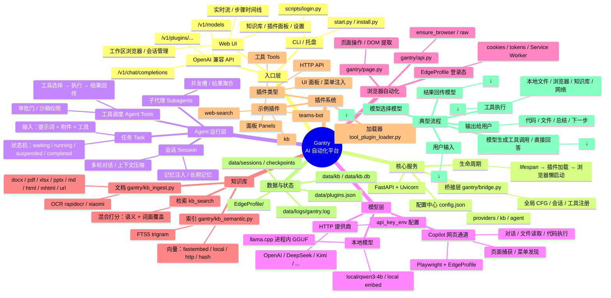

# Gantry 结构与流程 Mindmap

> 用文字 + Mermaid 描述 `gantry` 的整体架构、数据流与扩展点。
> 在支持 Mermaid 的 Markdown 阅读器（如 GitHub、VS Code、Typora）里可直接渲染。



## 一句话流程

```text
用户通过 WebUI/API 提交任务 → Agent 选模型 → 模型决定用工具/直接回答
→ 工具在沙箱/浏览器/知识库/网络执行 → 结果回传 → 循环直到完成
```

## 主要扩展点

1. **加模型**：在 `config.json` 的 `providers` 里新增 OpenAI 兼容端点，或放 GGUF 到 `data/models` 用 `local` 后端。
2. **加工具**：在 `plugins/<name>/plugin.py` 里 `ctx.register_tool(...)`。
3. **加面板**：`ctx.register_panel(...)`，数据由后端 API 提供。
4. **改 UI**：`webui/js/*.js` + `webui/css/*.css`，事件统一走 `data-act`。
